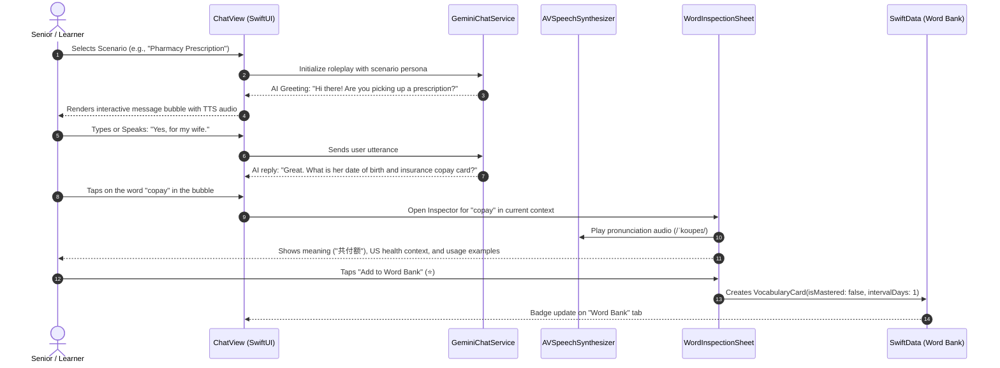

# DayBySay — Interactive AI Chat & Word Bank (Technical Design Document)

> **Feature:** Interactive AI Conversation Roleplay & One-Tap Word Bank  
> **Target App:** DayBySay (`day_by_say`)  
> **Status:** Draft / Ready for Implementation  
> **Target Platform:** iOS 17.0+ (SwiftUI, SwiftData, Google Gemini API)  
> **Primary Audience:** Immigrant elders and adult language learners practicing survival English  

---

## 1. Executive Summary & Problem Statement

### 1.1 The User Problem
While DayBySay's **Ambient Live Listen** feature captures passive real-world speech from grocery stores and doctor visits, users also need an **active, safe, zero-judgment sandbox** to practice speaking *before* they encounter these stressful situations in public.

However, traditional AI chat interfaces (like ChatGPT) fail language learners in two major ways:
1. **The "Blank Canvas" Paralysis:** Seniors and beginners do not know what prompts to type or how to initiate roleplay.
2. **The Passive Text Wall Barrier:** When the AI responds with natural idioms (e.g., *"cash back"*, *"copay"*, *"paper or plastic"*), users cannot interact with the words directly. If they don't know a word, they must copy-paste it into a separate dictionary app, breaking conversation immersion.

### 1.2 The Solution
We introduce an **Interactive AI Scenario Chat** with three core pillars:
1. **One-Tap Scenario Starters:** Curated survival scenarios (e.g., *Grocery Checkout*, *Pharmacy Pickup*, *Bus Commute*, *Doctor Consultation*) with pre-set context and initial greeting.
2. **Interactive Word-Tapping ("Tap-to-Inspect"):** Every word and phrase in the AI's response is an interactive touch target. Tapping any word opens an accessible bottom sheet with its definition, phonetic IPA, audio pronunciation, and cultural context.
3. **One-Tap "Add to Word Bank":** From the inspection sheet, users can immediately save the term into their local SwiftData study deck, feeding it directly into DayBySay's **SM-2 Spaced Repetition** review engine.

---

## 2. User Journey & Core Flow



---

## 3. System Architecture & Components

```mermaid
flowchart TD
    subgraph UI_Layer [Presentation Layer - SwiftUI]
        A[ScenarioPickerView] -->|Select Scenario| B[InteractiveChatView]
        B --> C[InteractiveMessageBubble]
        C -->|Word Tap Gesture| D[WordInspectionSheet]
        D -->|Add to Bank| E[Toast / Haptic Confirmation]
    end

    subgraph Logic_Layer [Service & State Layer]
        F[GeminiChatService]
        G[SpeechRecognizerService (Voice Input)]
        H[SpeechSynthesizerService (Audio Playback)]
        I[WordAnnotationService (Lexical Breakdown)]
    end

    subgraph Data_Layer [Persistence & Models - SwiftData]
        J[ConversationScenario (Preset Library)]
        K[ChatMessage (History & Tokens)]
        L[VocabularyCard (Word Bank & SM-2)]
    end

    B <-->|Streaming / Messages| F
    B <-->|Speech Input| G
    C -->|Listen to Sentence| H
    D -->|Listen to Word / IPA| H
    D -->|Get Definition & Cultural Usage| I
    I <-->|Cached or AI Lookup| F
    D -->|Persist New Word| L
    A <-->|Loads Scenarios| J
```

---

## 4. Feature Specifications

### 4.1 Scenario Starter Prompts (The "Zero-Friction" Launchpad)
The screen opens with horizontally scrollable or card-based starter situations tailored for immigrant survival:

| Scenario ID | Title (Dual-Language) | Roleplay Persona | Initial AI Message |
| :--- | :--- | :--- | :--- |
| `grocery_checkout` | 🛒 **Supermarket Checkout**<br>超市结账 | Friendly Supermarket Cashier | *"Hi! Did you find everything okay? Paper or plastic bags today?"* |
| `pharmacy_pickup` | 💊 **Pharmacy Prescription**<br>药房取药 | Community Pharmacist | *"Hello! Are you picking up a prescription or dropping one off?"* |
| `bus_transit` | 🚌 **Public Bus & Transit**<br>乘坐公交 | Bus Driver / Transit Worker | *"Exact fare is $2.75, or tap your metro card. Need a transfer?"* |
| `doctor_visit` | 🩺 **Doctor's Office Reception**<br>诊所登记 | Clinic Front Desk Receptionist | *"Good morning! Do you have an appointment with Dr. Miller? May I see your ID and insurance card?"* |
| `cafe_order` | ☕ **Coffee Shop & Diner**<br>咖啡馆点单 | Barista / Server | *"Morning! What can I get started for you today? For here or to go?"* |
| `neighbor_talk` | 🏡 **Neighbor Small Talk**<br>邻里日常交流 | Friendly American Neighbor | *"Good afternoon! Lovely weather today, isn't it? Did you get the package on the porch?"* |

---

### 4.2 Interactive Message Bubble ("Tap-to-Inspect")

#### Technical Implementation Challenge in SwiftUI:
Standard SwiftUI `Text` does not support discrete tap gestures on individual words inside continuous wrapped text.

#### Recommended Solution: Custom Tokenized Layout or Attributed Flow
1. **Message Pre-processing**:
   When a message arrives from the AI, a tokenization utility splits the string into:
   ```swift
   struct TextToken: Identifiable {
       let id = UUID()
       let text: String
       let isPunctuationOrSpace: Bool
       let cleanWord: String // stripped of punctuation, lowercased for lookup
   }
   ```
2. **Rendering via Wrapping Flow Layout**:
   Using iOS 16+ `Layout` protocol (`WrappingHStack` / `FlowLayout`) or an `AttributedString` with custom `customWord` URL attributes handled via `.environment(\.openURL)`.
3. **Touch Feedback**:
   - Tapping a word produces an immediate light haptic tick (`UIImpactFeedbackGenerator(style: .light)`).
   - The selected word is temporarily highlighted with a subtle primary color background pill.

---

### 4.3 Word Inspection Sheet (Bottom Sheet Modal)

When a word is tapped, an accessible sheet slides up (presentation detents: `.medium` and `.large`).

#### Content Display:
1. **Header**:
   - English Word in bold Dynamic Type (`.title2`).
   - Phonetic IPA (e.g. `[ˈkoʊpeɪ]`).
   - Audio Pronunciation button (uses `AVSpeechSynthesizer` with standard `1.0x` and slow `0.5x` turtle button).
   - Target Language Translation (e.g. `共付额 / 门诊定额自付`).
2. **Contextual Sentence**:
   - Highlights how the word was just used in the AI's exact conversation line.
3. **Real-World Usage Scenarios**:
   - 2 practical, spoken examples of how Americans use this word in real life.
4. **Cultural / Practical Etiquette Tip**:
   - E.g. for *"Copay"*: *"In the US healthcare system, a copay is a fixed fee you pay at the front desk before seeing the doctor, separate from what insurance pays."*
5. **Action Button**:
   - **"⭐️ Add to Word Bank"** (Large high-contrast button).
   - If already saved: Displays **"✓ Saved in Word Bank"** (disabled or allowing deletion).

---

### 4.4 One-Tap "Add to Word Bank" & Spaced Repetition Integration

When the user taps **"Add to Word Bank"**, the app constructs a `VocabularyCard` and inserts it into the SwiftData context:

```swift
let newCard = VocabularyCard(
    englishTerm: wordData.term,
    phoneticIpa: wordData.ipa,
    partOfSpeech: wordData.partOfSpeech,
    targetLanguageCode: userLanguageCode, // e.g., "zh-Hans" or "es"
    translatedMeaning: wordData.translation,
    contextSentence: currentMessageSentence,
    culturalExplanation: wordData.culturalNote
)

// Automatically configured for SuperMemo-2 Spaced Repetition
newCard.repetitionCount = 0
newCard.intervalDays = 1
newCard.easeFactor = 2.5
newCard.nextDueAt = Date() // Due immediately for first study session

modelContext.insert(newCard)
try? modelContext.save()
```

This immediately ties the chat feature into the existing **Flashcard Study Deck** (`VocabularyCardView.swift`), creating an unbroken loop between **conversation practice** and **long-term memory retention**.

---

## 5. Data Models & API Contracts

### 5.1 SwiftData / Swift Models

```swift
import Foundation
import SwiftData

/// Represents a chat session anchored to a specific scenario
@Model
public final class AIChatSession: Identifiable {
    @Attribute(.unique) public var id: UUID
    public var createdAt: Date
    public var scenarioId: String
    public var scenarioTitle: String
    
    @Relationship(deleteRule: .cascade)
    public var messages: [AIChatMessage]
    
    public init(scenarioId: String, scenarioTitle: String) {
        self.id = UUID()
        self.createdAt = Date()
        self.scenarioId = scenarioId
        self.scenarioTitle = scenarioTitle
        self.messages = []
    }
}

/// Represents individual user or AI messages
@Model
public final class AIChatMessage: Identifiable {
    @Attribute(.unique) public var id: UUID
    public var roleRaw: String // "user" or "model"
    public var content: String
    public var timestamp: Date
    
    public init(role: String, content: String) {
        self.id = UUID()
        self.roleRaw = role
        self.content = content
        self.timestamp = Date()
    }
}
```

### 5.2 Gemini Prompt Strategy

#### System Prompt for Roleplay:
```text
You are DayBySay AI, a kind, patient, and clear American community roleplay partner assisting immigrant elders learning practical survival English.

Current Roleplay Scenario: {{SCENARIO_TITLE}}
Your Persona: {{PERSONA_DESCRIPTION}}
Target Native Language: {{TARGET_LANGUAGE_NAME}}

Guidelines:
1. Speak in natural, spoken American English suitable for daily errands.
2. Keep replies concise (1-3 sentences) so the learner isn't overwhelmed.
3. If the user makes grammatical or pronunciation mistakes, respond warmly and understandingly without harsh corrections, modeling the correct phrase naturally.
4. Encourage them to answer.
```

#### Lexical Inspection Extraction Prompt (On-Demand or Pre-Annotated):
```json
{
  "term": "copay",
  "phoneticIpa": "/ˈkoʊpeɪ/",
  "partOfSpeech": "noun",
  "translation": "共付额 (定额挂号自付)",
  "contextExplanation": "The fixed dollar amount paid out-of-pocket at the front desk of a clinic.",
  "usageExamples": [
    "Do you have a $20 copay for today's office visit?",
    "Show your insurance card so they can calculate the copay."
  ],
  "culturalNote": "In the United States, insurance does not cover 100% of doctor visits; almost all plans require a copay at registration."
}
```

---

## 6. Accessibility & Senior UX Principles

1. **Large Touch Targets:** Each word in the chat bubble has minimum touch target padding (`minHeight: 44pt`) to prevent mistaps by older fingers.
2. **Dual-Speed Audio:** The inspection sheet provides both standard speed (1.0x) and senior speed (0.5x turtle button).
3. **Voice Input Option:** Integrates the existing `SpeechRecognizerService` so seniors can speak their replies instead of typing on a tiny mobile keyboard.
4. **Visual Contrast:** Complies with WCAG AAA standards: high-contrast dark text on warm tinted background cards.

---

## 7. Implementation Roadmap

| Phase | Milestone | Deliverables |
| :--- | :--- | :--- |
| **Phase 1** | **Scenario Launcher & Chat Engine** | `ScenarioPickerView.swift`, `GeminiChatService.swift` with multi-turn conversation memory. |
| **Phase 2** | **Interactive Tokenized Bubble UI** | `InteractiveMessageBubble.swift` with word segmentation and tap highlighting. |
| **Phase 3** | **Word Inspector Modal & Audio** | `WordInspectionSheet.swift` with IPA, translation, cultural notes, and dual-speed TTS. |
| **Phase 4** | **SwiftData Word Bank Sync** | Direct insertion of inspected words into `VocabularyCard` model for SM-2 spaced repetition. |

---

## 8. Summary of Benefits for Congressional App Challenge

- **Novelty:** Bridges generative AI roleplay with tactile lexicography (tap-to-learn).
- **Social Impact:** Tackles the real psychological barrier immigrant seniors face when trying to practice English in public.
- **Technical Rigor:** Integrates multi-turn LLM streaming, custom tokenized SwiftUI text layouts, AVFoundation speech synthesis, and persistent algorithmic spaced repetition.
