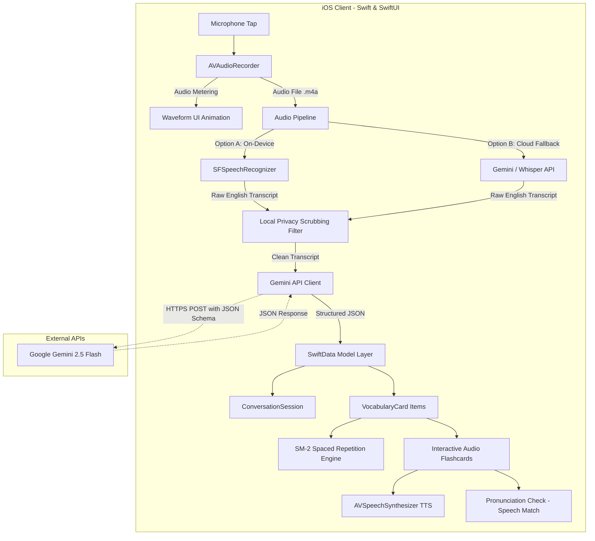

# DayBySay — Technical Design Document (RFC / Draft)

> **Status:** Approved for Implementation  
> **App Name:** DayBySay (`day_by_say`)  
> **Target Event:** Congressional App Challenge (CAC)  
> **Target Audience:** Non-English speaking immigrants (specifically elderly family members / seniors)  

---

## 1. Executive Summary & Goals

### 1.1 Goal
Build an accessible, senior-friendly iOS application that captures real, live daily conversations in the user's community, transcribes them, and uses an AI semantic engine to extract personalized, high-yield survival vocabulary, idioms, and polite responses into an audio-first spaced repetition learning deck.

### 1.2 Non-Goals for Initial MVP
- Complex user authentication / multi-user cloud accounts (keep it local, private, and zero-friction for seniors).
- Full conversational AI chatbots (the focus is learning from **real lived life**, not chatting with a bot).
- Social networking / leaderboards (distracting and intimidating for elderly users).

---

## 2. Technical Stack & Architectural Decisions (ADRs)

| Component | Technology | Rationale & Trade-offs |
| :--- | :--- | :--- |
| **Language** | **Swift 5.10 / Swift 6** | Apple's official, type-safe modern language; full interoperability with modern iOS frameworks. |
| **UI Framework** | **SwiftUI** | Declarative layout engine with native support for **Dynamic Type** (scaling fonts for seniors), VoiceOver accessibility, and fluid state-driven animations. |
| **Local Storage** | **SwiftData** (iOS 17+) | Modern replacement for CoreData using pure Swift `@Model` macros. Eliminates `.xcdatamodeld` boilerplate, highly performant on-device, and zero setup. |
| **Audio Capture** | **AVFoundation (`AVAudioRecorder`)** | Low-level control over audio sessions (`.playAndRecord`), audio format (AAC `.m4a`), sample rates (16kHz for STT), and real-time audio power metering (`averagePower`) for live waveforms. |
| **Audio Playback (TTS)**| **`AVSpeechSynthesizer`** | Native text-to-speech engine. **100% offline, zero latency, free.** High-fidelity natural American English (`en-US`) and Mandarin Chinese (`zh-CN`) voices. |
| **Speech-to-Text (STT)**| **Apple `Speech` (`SFSpeechRecognizer`)** + Cloud Fallback | Built into iOS for fast, on-device transcription with zero API cost. Can fall back to cloud STT (e.g. Whisper / Gemini Audio) if background noise is high. |
| **AI Semantic Engine** | **Gemini 2.5 Flash API** | Sub-second latency, low token cost, and strict native **JSON Schema mode** (Structured Outputs) guaranteeing deterministic parsing for flashcards. |
| **Spaced Repetition** | **Custom SuperMemo-2 (SM-2)** | Mathematical decay-curve algorithm implemented in pure Swift. Provides algorithmic sophistication on the CAC rubric. |

---

## 3. End-to-End System Architecture



---

## 4. Detailed Data Schemas

### 4.1 SwiftData Persistence Models

```swift
import Foundation
import SwiftData

@Model
final class ConversationSession {
    @Attribute(.unique) var id: UUID
    var createdAt: Date
    var audioDurationSeconds: Double
    var rawTranscript: String
    var scrubbedTranscript: String
    var scenarioCategory: String // e.g., "Grocery", "Transit", "Clinic", "Neighborhood"
    var suggestedPoliteReply: String
    
    @Relationship(deleteRule: .cascade, inverse: \VocabularyCard.session)
    var cards: [VocabularyCard]
    
    init(rawTranscript: String, scrubbedTranscript: String, category: String, politeReply: String, duration: Double) {
        self.id = UUID()
        self.createdAt = Date()
        self.rawTranscript = rawTranscript
        self.scrubbedTranscript = scrubbedTranscript
        self.scenarioCategory = category
        self.suggestedPoliteReply = politeReply
        self.audioDurationSeconds = duration
        self.cards = []
    }
}

@Model
final class VocabularyCard {
    @Attribute(.unique) var id: UUID
    var englishTerm: String            // e.g., "Copay"
    var phoneticIpa: String            // e.g., "/ˈkoʊpeɪ/"
    var partOfSpeech: String           // e.g., "noun"
    var targetLanguageCode: String     // e.g., "zh-CN", "es-US", "vi-VN"
    var translatedMeaning: String      // Definition in user's native language (e.g. "共付额" or "Copago")
    var contextSentence: String        // The exact sentence spoken in the conversation
    var culturalExplanation: String    // Why this matters in the US (in native language)
    
    // Spaced Repetition Parameters (SM-2)
    var repetitionCount: Int = 0
    var intervalDays: Int = 1
    var easeFactor: Double = 2.5
    var lastReviewedAt: Date?
    var nextDueAt: Date = Date()
    var isMastered: Bool = false
    
    var session: ConversationSession?
    
    init(englishTerm: String, phoneticIpa: String, partOfSpeech: String, targetLanguageCode: String, translatedMeaning: String, contextSentence: String, culturalExplanation: String) {
        self.id = UUID()
        self.englishTerm = englishTerm
        self.phoneticIpa = phoneticIpa
        self.partOfSpeech = partOfSpeech
        self.targetLanguageCode = targetLanguageCode
        self.translatedMeaning = translatedMeaning
        self.contextSentence = contextSentence
        self.culturalExplanation = culturalExplanation
        self.nextDueAt = Date()
    }
}
```

### 4.2 Gemini Extraction JSON Schema (Structured Output)

When sending the transcript to the AI, we enforce strict JSON structure dynamically parametrized by the user's selected native language:

```json
{
  "type": "OBJECT",
  "properties": {
    "scenarioCategory": {
      "type": "STRING",
      "description": "Category such as Grocery, Healthcare, Transit, Banking, Small Talk"
    },
    "scenarioSummary": {
      "type": "STRING",
      "description": "Brief 1-sentence summary of the encounter in the user's native language"
    },
    "suggestedPoliteReply": {
      "type": "STRING",
      "description": "A natural, simple phrase the senior can say back next time in English"
    },
    "suggestedPoliteReplyTranslation": {
      "type": "STRING",
      "description": "Translation of the suggested polite reply in the user's native language"
    },
    "vocabularyItems": {
      "type": "ARRAY",
      "items": {
        "type": "OBJECT",
        "properties": {
          "englishTerm": { "type": "STRING" },
          "phoneticIpa": { "type": "STRING" },
          "partOfSpeech": { "type": "STRING" },
          "translatedMeaning": { "type": "STRING" },
          "contextSentence": { "type": "STRING" },
          "culturalExplanation": { "type": "STRING" }
        },
        "required": ["englishTerm", "phoneticIpa", "translatedMeaning", "contextSentence"]
      }
    }
  },
  "required": ["scenarioCategory", "suggestedPoliteReply", "vocabularyItems"]
}
```

---

## 5. Multi-Language Architecture (English ➔ Any Immigrant Community)

While DayBySay was born from a personal need for Chinese-speaking grandparents, the Congressional App Challenge values **scalable civic impact**. We architect multi-language support as a first-class feature:

```swift
enum TargetLanguage: String, CaseIterable, Identifiable {
    case simplifiedChinese = "zh-Hans"
    case traditionalChinese = "zh-Hant"
    case spanish = "es"
    case vietnamese = "vi"
    case korean = "ko"
    case tagalog = "tl"
    case arabic = "ar"
    
    var id: String { rawValue }
    
    var displayName: String {
        switch self {
        case .simplifiedChinese: return "简体中文 (Chinese Simplified)"
        case .traditionalChinese: return "繁體中文 (Chinese Traditional)"
        case .spanish: return "Español (Spanish)"
        case .vietnamese: return "Tiếng Việt (Vietnamese)"
        case .korean: return "한국어 (Korean)"
        case .tagalog: return "Tagalog"
        case .arabic: return "العربية (Arabic)"
        }
    }
    
    var ttsLocaleIdentifier: String {
        switch self {
        case .simplifiedChinese: return "zh-CN"
        case .traditionalChinese: return "zh-TW"
        case .spanish: return "es-US"
        case .vietnamese: return "vi-VN"
        case .korean: return "ko-KR"
        case .tagalog: return "fil-PH"
        case .arabic: return "ar-SA"
        }
    }
}
```

### Dynamic AI Prompt Injection
When calling Gemini, we inject:
> *"The user's native language is **\(targetLanguage.displayName)**. Provide all definitions, cultural context explanations, and polite reply translations in **\(targetLanguage.displayName)**."*

---

## 6. How to Get & Configure the Gemini API Key

### 6.1 Getting a Free API Key
1. Go to **Google AI Studio** at [https://aistudio.google.com/](https://aistudio.google.com/).
2. Sign in with your standard Google Account.
3. In the left navigation, click **"Get API key"**.
4. Click **"Create API key"** (you can create a new project or select an existing one).
5. Copy your key (starts with `AIzaSy...`).
   * *Free Tier Limits:* Gemini 2.5 Flash offers **15 Requests Per Minute (RPM)** and 1,500 Requests Per Day for free, which is more than enough for development, testing, and live CAC demonstrations.

### 6.2 Secure Local Configuration (No Key Leaks)
We store the key locally so it is never committed to GitHub:
1. Create a `Secrets.xcconfig` file in the project (added to `.gitignore`):
   ```text
   GEMINI_API_KEY = your_actual_api_key_here
   ```
2. Read the key into `Info.plist` via `$(GEMINI_API_KEY)` and access it cleanly in Swift:
   ```swift
   enum APIConfig {
       static var geminiKey: String {
           Bundle.main.object(forInfoDictionaryKey: "GeminiAPIKey") as? String ?? ""
       }
   }
   ```

---

## 7. Senior-Centric UX & Accessibility Specifications

Elderly users require distinct interface ergonomics ("Silver Economy" design):

1. **Touch Targets:** Minimum button height of **60pt** (Apple standard is 44pt).
2. **Typography:** Minimum body font **22pt**, header font **32pt+**, with heavy font weights (Bold/Semibold) to assist deteriorating vision.
3. **Contrast Ratio:** Strict adherence to **WCAG AAA** (minimum 7:1 contrast ratio) using deep slate backgrounds with high-vibrancy text.
4. **Zero Hidden Gestures:** No complex swipe-to-delete, multi-finger taps, or deep nested menus. Every major action has an explicit, high-contrast button.
5. **Audio-First Interactions:** Every card has a distinct speaker button (🔊) that reads both the English term and its contextual sentence aloud via `AVSpeechSynthesizer`.
6. **Dual-Language Parallel View:** English term in bold on top; Native translation directly below.

---

## 8. iOS Development & Deployment Workflow

```
[Mac Development]                      [Testing Device]
   Xcode Project ───────────► Run (Cmd+R) ───────────► iPhone Simulator (Mac)
         │                                               - Fast UI layout check
         │                                               - Dark / Light mode
         ▼                                               - Dynamic font scaling
   Plug in Physical iPhone (USB / Wi-Fi)
         │
         ▼
   Free Personal Provisioning Profile (No $99 Apple fee)
         │
         ▼
   Run on Real iPhone (Physical Device)
         - Real microphone permissions & noise handling
         - Real AVSpeechSynthesizer audio output
         - In-the-field testing with Grandparents at local stores
```

---

## 9. Concrete Execution Plan: From MVP to CAC Winner

```
┌─────────────────────────────────────────────────────────────┐
│ Milestone 0: Setup & Real-Device "Hello World"              │
│ - Xcode project, permissions, microphone Info.plist         │
└──────────────────────────────┬──────────────────────────────┘
                               │
                               ▼
┌─────────────────────────────────────────────────────────────┐
│ Milestone 1: The Core MVP (The "Live Listen" Loop)          │
│ - 1 Screen: Live Listen -> Apple SFSpeechRecognizer         │
│   -> Gemini AI -> 3 Bilingual Flashcards                    │
└──────────────────────────────┬──────────────────────────────┘
                               │
                               ▼
┌─────────────────────────────────────────────────────────────┐
│ Milestone 2: Audio & Data Persistence                       │
│ - SwiftData database + AVSpeechSynthesizer audio playback   │
│ - Multi-language support toggle (Chinese, Spanish, etc.)    │
└──────────────────────────────┬──────────────────────────────┘
                               │
                               ▼
┌─────────────────────────────────────────────────────────────┐
│ Milestone 3: Senior UI & Spaced Repetition (SM-2)           │
│ - High-contrast screens, daily review deck, Leitner/SM-2    │
└──────────────────────────────┬──────────────────────────────┘
                               │
                               ▼
┌─────────────────────────────────────────────────────────────┐
│ Milestone 4: Interactive Enhancements                       │
│ - "Debrief / Voice Memo" secondary mode                     │
│ - "Say It Back" pronunciation evaluator + PII Scrubber      │
└──────────────────────────────┬──────────────────────────────┘
                               │
                               ▼
┌─────────────────────────────────────────────────────────────┐
│ Milestone 5: Congressional App Challenge Polish             │
│ - 3-min video recording, real demo footage, rubric audit    │
└─────────────────────────────────────────────────────────────┘
```

---

## 10. Decisions & Alignment Log

1. **Speech Recognition Engine:**
   - *Decision:* Prototype and validate with Apple's native `SFSpeechRecognizer` first for zero-setup, on-device capability. If background noise in noisy stores requires higher fidelity, add cloud STT fallback.
2. **Gemini API Key:**
   - *Decision:* Free tier via Google AI Studio (`aistudio.google.com`), securely loaded through `Secrets.xcconfig` (ignored by git).
3. **Capture Mode Priority:**
   - *Decision:* **Live Listen Mode** is the #1 priority for Milestone 1 MVP. Post-encounter Debrief Mode is deferred to Milestone 4.
4. **Multi-Language Support:**
   - *Decision:* Fully supported in the core data model (`VocabularyCard.targetLanguageCode`) and dynamic prompt injection. Defaulting to Simplified Chinese for grandparents, with one-tap switching to Spanish, Vietnamese, Korean, etc. for broad community and CAC presentation appeal.
