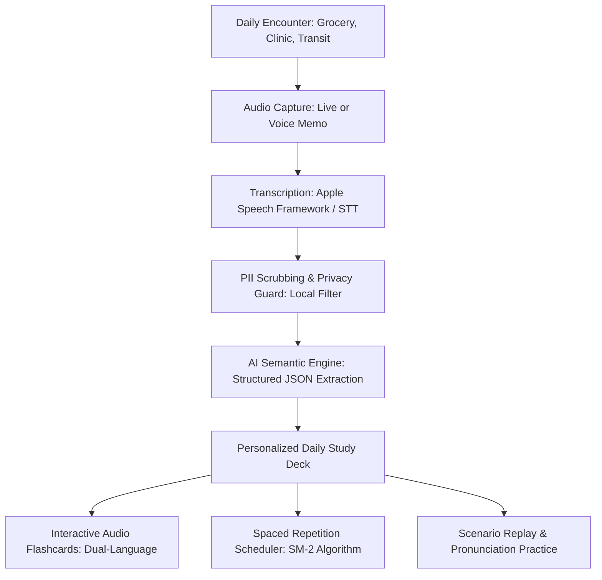

# DayBySay (`day_by_say`) — Project Overview

---

## 1. Brand Identity & Taglines

### 1.1 Name & Taglines
* **App Name:** **DayBySay** (`day_by_say`)
* **Primary Tagline:**  
  > **"Learning English, day by say."**  
  *(A play on "day-by-day" and "what people say"—capturing steady, daily progress through authentic living speech.)*

* **Secondary & Supporting Taglines:**
  * *"Turn today’s live conversations into tomorrow’s confidence."*
  * *"Real English from your real day."*
  * *"From hearing daily life to making it home."*

### 1.2 Official Pitches
* **One-Sentence Elevator Pitch (CAC Registration Form):**  
  > *"DayBySay is an accessible iOS application that empowers non-English-speaking immigrants to master practical survival English by converting their real, live daily conversations into personalized, audio-first learning decks."*

* **30-Second Video Pitch Hook (For the CAC Submission Video):**  
  > *"When my grandparents moved to New Jersey from China, language apps taught them phrases like 'the green turtle drinks milk.' But in real life, what they actually needed was to understand the cashier at the grocery store, the bus driver on NJ Transit, and the doctor at the clinic. That's why I created **DayBySay**—an app that listens to the real world around our immigrant elders and turns today's live conversations into personalized, senior-friendly English lessons."*

### 1.3 Core Brand Pillars
1. **Daily (Everyday Life):** Grounded in routine, hyper-local community encounters rather than disconnected abstract vocabulary.
2. **Live Spoken (Authentic Speech):** Capturing the rhythm, idioms, and speed of real American spoken English.
3. **New Immigrant Belonging (Independence & Dignity):** Eliminating the fear of daily errands and empowering newcomers to navigate their new home with confidence.

---

## 2. Problem Statement & Motivation

### 2.1 The Core Problem
When new immigrants—particularly elderly family members—arrive in the United States, language acquisition is their greatest hurdle to independence and community belonging. 

Existing solutions fail them:
- **Gamified Apps (e.g., Duolingo):** Teach rigid, repetitive, textbook sentences (*"The green bear drinks milk"*) that have zero relevance to survival English.
- **Traditional ESL Classrooms:** Require strict schedules and formal grammar studies, disconnected from the hyper-local situations seniors encounter every day.
- **The "Unspellable" Audio Barrier:** When an immigrant senior hears a cashier say *"Paper or plastic?"*, a bus driver say *"Exact fare or transfer ticket"*, or a doctor explain *"Take two tablets twice daily with meals"*, **they do not know how to spell what they just heard**. As a result, they cannot look it up in a dictionary or Google Translate. The learning moment is lost forever.

### 2.2 The Motivation & Origin Story
Inspired by the real-world experience of grandparents arriving from China to New Jersey, **DayBySay** bridges the gap between living life and learning language. Instead of abstract curricula, DayBySay treats **everyday lived experience as the textbook**.

---

## 3. Congressional App Challenge (CAC) Alignment

The **Congressional App Challenge** is the official computer science competition hosted by Members of the U.S. House of Representatives.

### 3.1 Why DayBySay Fits the CAC Rubric

| Judging Criterion | How DayBySay Excels |
| :--- | :--- |
| **Ideology & Community Impact** | Directly addresses immigrant integration, senior independence, and educational equity—bipartisan civic issues deeply relevant across U.S. congressional districts (and specifically diverse states like New Jersey). |
| **Technical Merit & Execution** | Demonstrates a full-stack native mobile pipeline: on-device audio processing, speech-to-text recognition, structured LLM extraction, database persistence, and algorithmic spaced repetition (SM-2). |
| **User Experience & Accessibility** | Tailored for senior citizens (the "Silver Economy"): high-contrast dynamic typography, tactile one-touch controls, audio-first playback, and dual-language visual support. |
| **Storytelling & Video Presentation** | Provides an emotional, authentic narrative: real immigrant grandparents overcoming isolation and mastering daily life through an app built by their grandchild. |

---

## 4. Core App Workflow & Architecture

### 3.1 Step-by-Step User Journey

1. **Audio Capture (Dual-Mode Design):**
   * **Active Live Mode:** One-tap recording when the user is at a counter, bus stop, or interacting with a neighbor.
   * **Post-Encounter Voice Memo ("Debrief Mode"):** If real-time recording wasn't appropriate, the user or a family member can simply dictate a brief voice summary (*"The pharmacist said my copay is ten dollars and take it with food"*).
2. **Speech-to-Text (STT):**
   * High-accuracy transcription converting spoken English audio into clean text.
3. **Privacy & Ethical Filter (PII Scrubbing):**
   * On-device scrubbing of sensitive data (phone numbers, card numbers, addresses) before AI processing, ensuring ethical compliance.
4. **Structured AI Extraction:**
   * An intelligent language model analyzes the transcript to extract:
     * **3–5 Essential Vocab / Phrases** (*e.g., "copay", "refill", "take with meals"*).
     * **Contextual Meaning & Nuance:** Why this phrase was used in this specific American context.
     * **Bilingual Translation & Pronunciation:** Target translation (Simplified Chinese) + phonetic cues.
     * **Next-Time Response Suggestion:** A polite, natural phrase the senior can say back next time.
5. **Interactive Learning & Spaced Repetition (SRS):**
   * Automatically adds cards to the user's personal deck.
   * Uses an algorithmic review schedule (SuperMemo-2 / Leitner Box) so words are revisited right before they are forgotten.
   * Native audio playback (`AVSpeechSynthesizer`) allows hands-free, clear pronunciation listening.

---

## 5. Senior-Centric Design Principles (Silver Economy UX)

1. **Audio-First Interface:** Non-native seniors learn better through their ears than dense text. Every card, phrase, and button features clear, natural-speed speech synthesis.
2. **High-Contrast & Large Touch Targets:** Generous padding, Apple Dynamic Type sizing (minimum 20pt+ for core content), and clutter-free screens.
3. **One-Touch Simplicity:** A massive, inviting microphone button on the home screen eliminating complex navigation.
4. **Bilingual Dual-View:** English on top with native language (Simplified Chinese) directly below, fostering comprehension without friction.

---

## 6. Technical Stack

- **Target Platform:** iOS 17+ (iPhone)
- **UI Framework:** Swift & SwiftUI
- **Audio Processing:** `AVFoundation` (Recording & Playback), `AVSpeechSynthesizer` (Text-to-Speech)
- **Transcription Engine:** Apple `Speech` Framework (`SFSpeechRecognizer`) / Cloud STT
- **AI Knowledge Engine:** Gemini API / Structured JSON Output
- **Local Storage & State:** SwiftData / CoreData
- **Learning Algorithm:** Custom implementation of the SuperMemo-2 (SM-2) Spaced Repetition algorithm

---

## 7. Deliverables & Milestones for CAC Submission

- [ ] **Phase 1: Foundation & Data Architecture**
  - Initialize native Xcode SwiftUI project in `/Users/chenshuo/projects/day_by_say`.
  - Build the SwiftData models (`ConversationSession`, `VocabularyCard`, `ReviewHistory`).
- [ ] **Phase 2: Audio & Transcription Pipeline**
  - Build the one-tap audio recorder with waveform visualizer.
  - Integrate Apple Speech recognition and handle permission states.
- [ ] **Phase 3: AI Extraction Engine**
  - Define the structured JSON schema for conversation parsing.
  - Implement the API connector to transform raw transcripts into bilingual flashcards.
- [ ] **Phase 4: Senior-Friendly UI & Spaced Repetition**
  - Implement the Home, Learning Hub, and Flashcard Review screens.
  - Code the SM-2 review scheduler and pronunciation practice view.
- [ ] **Phase 5: Submission Polish (Video & Documentation)**
  - Draft the 1–3 minute demonstration video script.
  - Record live demo with grandparents in real-world scenarios.
  - Complete written responses addressing technical obstacles and community impact.
